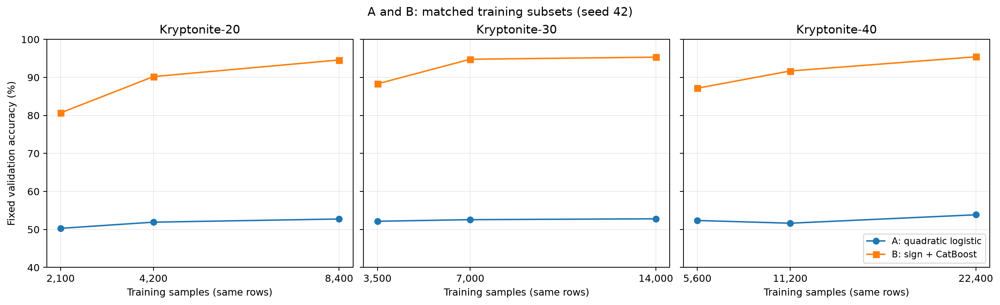
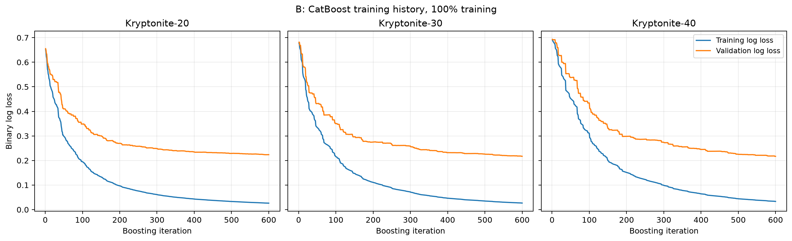

# Group discussion: methods, learning curves and loss

Snapshot: `main` contains A's baseline, C's MLP experiments and D's LoRA work; B's matched follow-up is recorded here. C's `neural_networks` branch at commit `1eee487` was merged into `main` by the group.

## 1. What each track does

| Member | Design framework | Data | Evidence currently available |
|---|---|---|---|
| A | Majority baseline; linear logistic regression; raw degree-2 polynomial features followed by L2 logistic regression | K20, K30, K40 | Fixed-validation accuracy by training size and convergence records |
| B | Transform each input feature into its sign, then train CatBoost, a gradient-boosted decision-tree model | K20, K30, K40 | Matched-subset accuracy and log loss; per-iteration training/validation log loss; multiple model and subset checks |
| C | Two-layer ReLU MLP trained from scratch, with training-only standardization | K20, K30, K40 | Width and three-seed validation comparison; locked models evaluated on local test |
| D | Load pretrained KryptoNet-40, freeze base hidden weights and apply LoRA updates; compare zero-shot and a linear probe | K40-Adapt | Validation accuracy; rank and model-seed experiments |

Data split for each labelled dataset: stratified 70% training, 20% validation, 10% local test, split seed 67. B has used the K20, K30 and K40 validation sets in development and has not scored its models on local test. C reports having locked its models and evaluated the K20, K30 and K40 local-test partitions. The group should agree how to preserve and interpret those results before further model selection. D's K40-Adapt task, pretrained weights and model selection differ from A/B and should be discussed separately.

## 2. A and B: learning curves on the same rows

For this comparison, B was rerun on A's saved seed-42 nested subsets. The 25%, 50% and 100% refer to the shared training split; within each dataset, both methods use the same training rows and fixed validation rows. One subset seed is shown. A's values are from its published `results/baseline_runs.csv`, and B's are from the new matched rerun with model seed 67.

| Dataset | Method | 25% training | 50% training | 100% training |
|---|---|---:|---:|---:|
| K20 | A: quadratic logistic | 50.29% | 51.92% | 52.75% |
| K20 | B: sign + CatBoost | 80.67% | 90.21% | 94.58% |
| K30 | A: quadratic logistic | 52.15% | 52.58% | 52.80% |
| K30 | B: sign + CatBoost | 88.30% | 94.78% | 95.33% |
| K40 | A: quadratic logistic | 52.36% | 51.64% | 53.86% |
| K40 | B: sign + CatBoost | 87.16% | 91.69% | 95.42% |

In these configurations, A's validation accuracy remains near 50–54%. B's validation accuracy is higher and improves with sample size across the three measured points. This comparison changes both the input representation and model family, and the search budgets differ. It does not isolate either cause. These are development scores, and the common subsets have not yet been confirmed as the group's final comparison protocol.

A and B originally used different 25% and 50% rows. The original seed 67 fixes the shared 70/20/10 split. Selecting smaller portions inside the shared training split requires a further choice of indices; A saved seed-42 subsets, while B's older learning curve averaged subset seeds 67, 123 and 314. B has now been rerun using A's saved rows for this comparison. At 100% the rows are the same. A's original accuracy uncertainty bars and B's subset-seed standard deviations measure different quantities; no such error bars are shown here.

## 3. B: loss over boosting iterations

For binary classification, log loss uses predicted class probabilities and penalises confident errors. Accuracy uses the predicted class. Both can help describe a model, with probability calibration and threshold choice affecting interpretation.

We retrained the three fixed 600-iteration CatBoost candidates on all shared training rows and recorded log loss after each iteration. `use_best_model=False` and no early stopping were used. Final validation predictions and probabilities exactly match B's earlier full-training runs on this machine. At iteration 600, the train/validation log losses are 0.0263/0.2236 for K20, 0.0267/0.2170 for K30 and 0.0333/0.2169 for K40. Both curves fall, with a training–validation gap; this helps describe fit and generalisation for the current candidate.

## 4. C: scratch MLP

C standardizes each feature using the training partition and fits a ReLU network with two hidden layers. The experiments compare widths 128 and 256 with training seeds 42, 123 and 2026. The wider network was selected by mean validation accuracy on the shared split; its validation means were **90.57% on K20, 91.03% on K30 and 93.49% on K40**. These are three-seed means at full training size, rather than a 25%/50%/100% sample-size learning curve. A matched-size curve requires new runs by C if the group decides it is useful.

C's report states that its 18 checkpoints were locked before it evaluated the local-test partitions. The local-test scores should remain final-assessment evidence; they should not drive a new choice of model, seed or threshold. Source: [`member_c/report/p3_findings.md`](../member_c/report/p3_findings.md).

## 5. D: current adaptation results

K40-Adapt has 2,800 training and 800 validation examples. The executed adaptation notebook reports validation accuracy across seeds 42, 123 and 2026:

| Method | Validation accuracy | Trainable parameters |
|---|---:|---:|
| Zero-shot KryptoNet | 49.00% | 0 |
| Linear probe | 52.42% ± 0.32 pp | 513 |
| LoRA rank 1 | 96.33% ± 0.07 pp | 4,137 |
| LoRA rank 2 | 95.67% ± 1.23 pp | 7,761 |
| LoRA rank 4 | 96.29% ± 0.19 pp | 15,009 |
| LoRA rank 8 | 96.17% ± 0.19 pp | 29,505 |

The ± values are sample SD across three training seeds on the same validation set. The linear probe reinitialises the head, while LoRA trains the pretrained head as well as low-rank updates; these changes are combined in this comparison. The current rank grid fixes alpha at 8, so alpha/r changes with rank. Saved histories and metrics are present, while the `trainable_state.pt` files referenced by the CSV were excluded by `.gitignore`; the group needs to confirm how to reconstruct or share final weights.

## 6. What to discuss and decide

1. **A/B:** confirm the seed-42 subset indices as a shared protocol, compare the two matched curves, and explain different representations and tuning effort.
2. **C:** review its MLP validation evidence and decide whether it should run the same nested subsets for a sample-size curve.
3. **D:** review the LoRA derivation and the head-initialisation/rank-scaling controls; decide whether an Adapt training-size curve is useful and how to retain final weights.
4. **All:** agree what to report as a learning curve by sample count and what to call a training history by iteration or epoch. Record split, subset, model seed, settings, metrics, duration and hardware.
5. **Final evaluation:** account for C's already opened local-test results; agree candidate selection, refit and evaluation procedures without using those results for further tuning. Verify final prediction files and the coursework submission route.

## 7. Reproduction and sources

- [Executed figure notebook](../GroupComparison.ipynb) generates the figures in `docs/figures/`. They are for group discussion; final paper formatting and Type-1 font embedding remain to be checked.
- [A's baseline protocol](baseline_experiments.md), `../results/baseline_runs.csv` and `../BaselineResults.ipynb` contain its original runs.
- [B's matched-subset results and verification](../B_Traditional_ML/results/aligned_a_subsets/README.md); [B's original three-seed learning curve](../B_Traditional_ML/results/learning_curve/实验记录.md); [B's data-isolation audit](../B_Traditional_ML/results/integrity_audit/审计结论.md).
- `../B_Traditional_ML/results/training_loss_curves/` contains B's per-iteration histories and source fingerprints.
- `../AdaptationResults.ipynb`, `../results/adapt_runs.csv`, `../results/adapt/` and [LoRA derivation](lora_derivation.md) contain D's evidence.
- [C's README](../member_c/README.md), [MLP methodology](../member_c/report/mlp_methodology.md) and [findings](../member_c/report/p3_findings.md) contain C's materials, originally published at `1eee487`.
